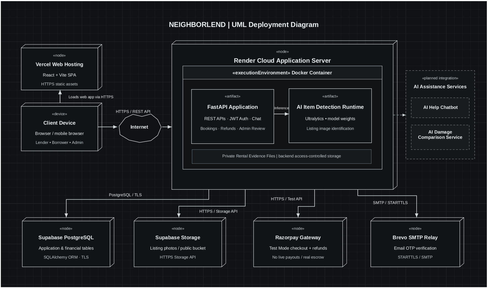

{ .tiet-logo }

**UCS503: Software Engineering (Project)**  
**TIET Patiala**

# NeighborLend: A Hyper-Local Peer-to-Peer Rental Platform

**Group:** 3Q14, B.E. Third Year, Computer Science and Engineering  
**Submitted to:** Ms. Sandeep Kaur

**Live application:** <https://neighborlend.vercel.app>  
**Application source code:** [aviraj1576/NeighborLend](https://github.com/aviraj1576/NeighborLend)
(linked as the [`code/`](https://github.com/aviraj1576/ucs503p-202627-NeighborLend-project/tree/master/code) folder of this repository)

NeighborLend lets people rent out things they rarely use, such as tools,
cameras and sports equipment, to other people nearby. It covers the whole
rental: listing an item with help from an object-detection model, finding it
with a location search, agreeing on a price in chat, paying the rent and a
refundable deposit, recording the item's condition at handover and return,
and settling damage claims.

## Team

| Roll No.   | Name                     | Main contribution | Journal |
|------------|--------------------------|-------------------|---------|
| 1024170101 | Harsimrat Singh Malhotra | AI-based damage comparison, handover and return workflow, test case design | [Journal](journals/1024170101-harsimrat/index.md) |
| 1024170102 | Aviraj Singh             | Frontend, SVD recommendation system, SVM negotiation chatbot | [Journal](journals/1024170102-aviraj/index.md) |
| 1024170105 | Tikshan Garg             | YOLO object-detection model, Razorpay Test Mode payments and deposit accounting | [Journal](journals/1024170105-tikshan/index.md) |
| 1024170118 | Vansh Kapil              | Backend and module integration, deployment | [Journal](journals/1024170118-vansh/index.md) |

## Reports

| Stage | Report |
|-------|--------|
| Project proposal | [neighborlend-proposal.pdf](https://github.com/aviraj1576/ucs503p-202627-NeighborLend-project/blob/master/project-proposal/neighborlend-proposal.pdf) |
| Prototype stage (mid-semester) | [neighborlend-prototype-report.pdf](https://github.com/aviraj1576/ucs503p-202627-NeighborLend-project/blob/master/project-report-prototype-stage/neighborlend-prototype-report.pdf) |
| Final report (end-semester) | [neighborlend-final-report.pdf](https://github.com/aviraj1576/ucs503p-202627-NeighborLend-project/blob/master/project-report-final/neighborlend-final-report.pdf) |

The final report contains all UML and data-flow diagrams, the screenshots and
the test cases.

## Problem

People often need an item for a day or two and do not want to buy it, while
the same item sits unused in someone else's home nearby. Borrowing usually
happens through friends or informal groups, so items are hard to find, and
there is no common way to agree on a price, take a deposit, or settle a
disagreement about damage.

## What the system does

- **Accounts:** registration with a CAPTCHA and email OTP verification, login, Google sign-in, profiles with a trust score.
- **Listings:** item details and photos; a YOLO model trained on rentable item classes suggests what the item is from its photo; a rule-based suggestion for the daily rent and deposit.
- **Discovery:** browse and search by keyword, category and distance from the user's location.
- **Chat and negotiation:** a conversation per listing, with offers, counter-offers, acceptance and rejection. An accepted offer creates the booking.
- **Payment:** rent and refundable security deposit through Razorpay **Test Mode**, with the deposit tracked in a balanced, simulated ledger.
- **Handover and return:** condition photos at handover and at return, confirmed by the other party.
- **Damage claims:** the lender can raise a claim, the borrower can respond, and an administrator decides any deduction. AI-based photo comparison gives advisory findings only.
- **Ratings:** both parties rate each other after the rental.

## Architecture



The React single-page app is served from Vercel and calls a FastAPI REST API
running in a Docker container on Render. Data is stored in PostgreSQL on
Supabase, and listing photos in Supabase Storage. Razorpay (Test Mode)
handles payments and refunds, and Brevo delivers verification emails.

## Technology stack

| Layer | Technologies |
|-------|--------------|
| Frontend | React, Vite, JavaScript, HTML, CSS |
| Backend | Python, FastAPI, SQLAlchemy, REST APIs, JWT authentication |
| Database and storage | PostgreSQL and Storage on Supabase |
| Object detection | YOLO (Ultralytics, PyTorch), served with ONNX Runtime |
| Other AI features | SVD recommendations, SVM negotiation chatbot, AI-based damage comparison (experimental) |
| Payments | Razorpay Test Mode, simulated deposit accounting |
| Hosting | Vercel (frontend), Render with Docker (backend) |
| Tools | Git, GitHub, VS Code, Docker, Pytest |

## Repository layout

| Path | Contents |
|------|----------|
| `project-proposal/`, `project-report-prototype-stage/`, `project-report-final/` | The three reports (PDF) |
| `journals/` | One folder of weekly journal entries per team member |
| `docs/` | This project page |
| `code/` | The application, linked as a git submodule to [aviraj1576/NeighborLend](https://github.com/aviraj1576/NeighborLend) |

To clone this repository together with the application code:

``` shell
git clone --recurse-submodules https://github.com/aviraj1576/ucs503p-202627-NeighborLend-project.git
```

## Limitations

- Payments run in Razorpay **Test Mode** only, so no real money moves. The
  security deposit is a simulated ledger entry, not real escrow, and there are
  no payouts to lenders.
- The AI damage comparison is experimental. Its results vary with lighting,
  angle and background, so it only advises; an administrator makes every
  deduction decision.
- The object-detection model recognises only the item classes it was trained on.
